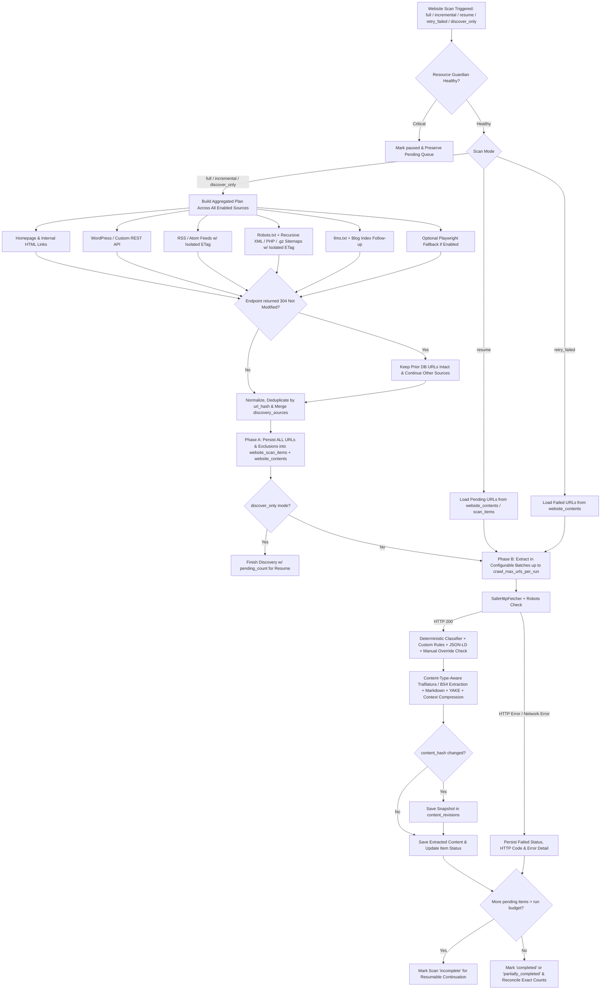
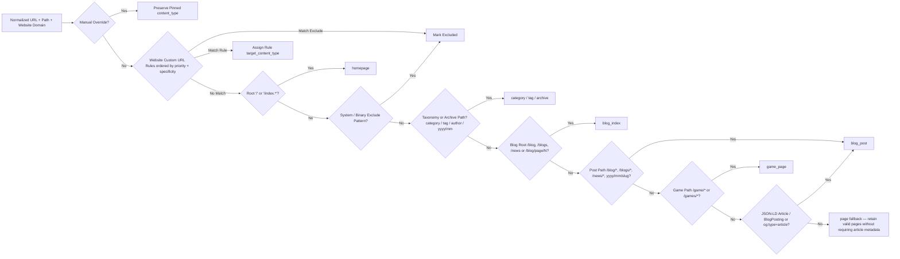
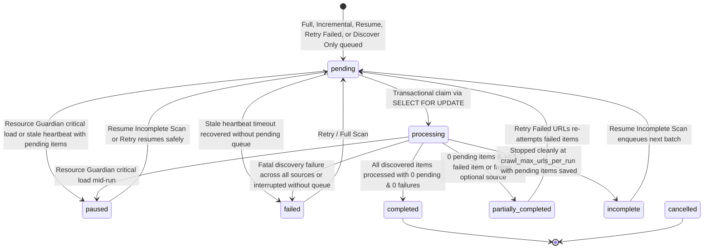
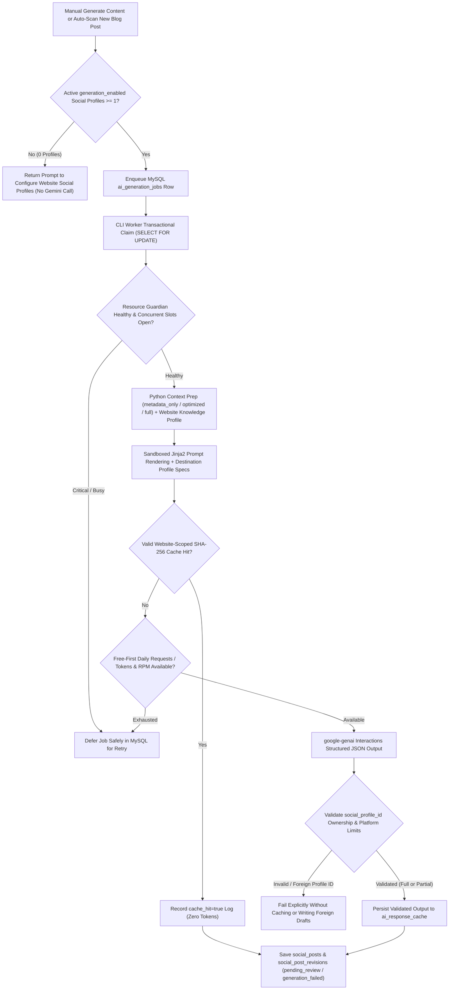
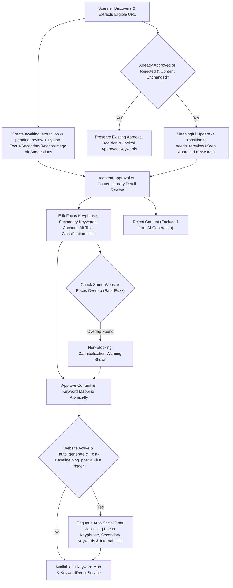
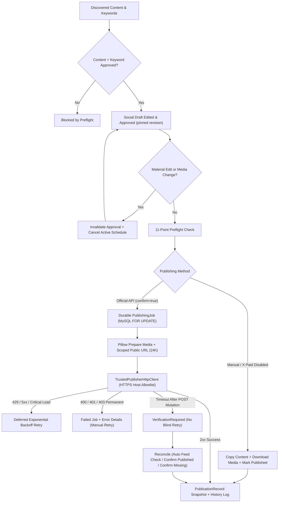
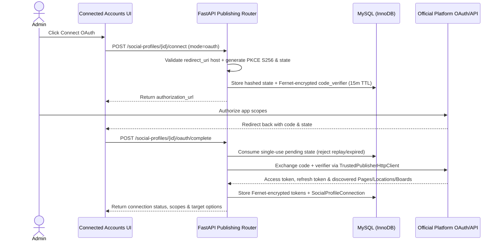
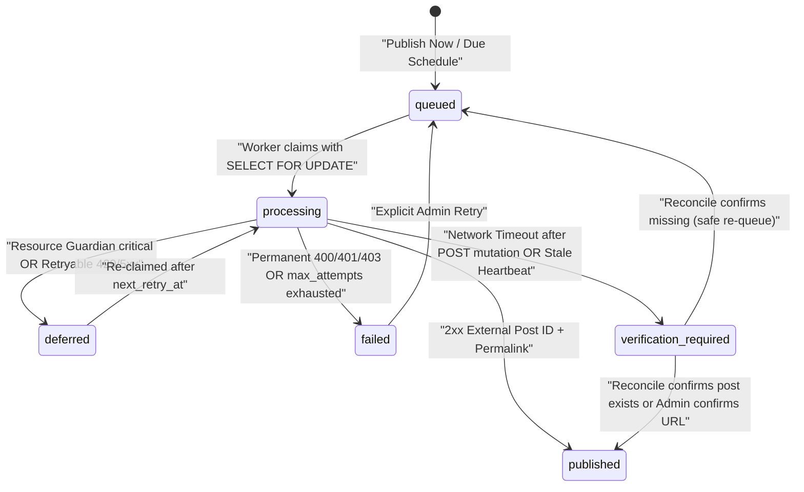

# ContentHub AI — Architecture

## 1. Architectural Style

ContentHub AI uses a **modular monolith** architecture paired with **separate Python background execution** (Phase 2/2.1 detached scan executor & scheduled CLI; full persistent job worker in Phase 6). It runs safely alongside production websites on a single aaPanel Linux server (`Asia/Manila` default display timezone) using existing MySQL without Redis, Celery, SQLite, or Docker requirements.

## 2. Three Independent Components

```text
                       ┌──────────────────────────────┐
                       │    Nginx (aaPanel Reverse    │
                       │    Proxy / Private Access)   │
                       └───────┬──────────────┬───────┘
                               │ /            │ /api/
                               ▼              ▼
             ┌──────────────────────┐   ┌──────────────────────────┐
             │  1. Nuxt 4 Frontend  │   │  2. FastAPI Backend API  │
             │  (PM2, :3100, TS)    │──▶│  (Supervisor, :8100)     │
             └──────────────────────┘   └────────────┬─────────────┘
                                                     │
                                                     │ SQLAlchemy + PyMySQL
                                                     │ (pool=3, overflow=2)
                                                     ▼
                                        ┌──────────────────────────┐
                                        │  Existing aaPanel MySQL  │
                                        │  (InnoDB, utf8mb4,       │
                                        │   FULLTEXT, Scan Items)  │
                                        └────────────▲─────────────┘
                                                     │
                                                     │ Row-locked claiming &
                                                     │ MySQL advisory locks
                                                     ▼
                                        ┌──────────────────────────┐
                                        │ 3. Python Background     │
                                        │    Executor & Worker     │
                                        │ (Phase 2.1 CLI + Phase 6)│
                                        └──────────────────────────┘
```

1. **Nuxt 4 Frontend (`frontend/` — Active Phases 1–3):** Desktop-first administrative dashboard built with Nuxt 4 (`app/` directory), TypeScript, Tailwind CSS v4, Nuxt UI v4, Pinia, and Lucide Icons. Employs a **Website-Centric** workspace (no standalone `/brands`), 7-tab `/websites/[id]` workspace (including `Social Profiles` & `AI Settings`), Universal Content Library with Generate Social modal, **AI Management Center** (`/ai-management`), and **Social Media Draft Queue** (`/social-media`).
2. **FastAPI Backend (`backend/` — Active Phases 1–3):** Python 3.12 REST API handling auth, CSRF, Settings/Categories, Website + merged Brand management, URL Rules, Discovery Sources, Content Library, Media assets, Website Social Profiles, Gemini AI configurations, Website Knowledge Profiles, Sandboxed Prompts, Response Cache, Generation Jobs/Usage/CSV History, and Draft Management.
3. **Python Background Executor & Worker (`backend/app/cli.py`, `backend/workers/`):** Non-blocking detached scan and AI generation execution (`run-scan`, `run-due-scans`, `run-ai-job`, `run-pending-ai-jobs`) with MySQL advisory locking & row-locked `FOR UPDATE` claiming, batched checkpoints, stale recovery, and `psutil` Resource Guardian deferral.

## 3. Website-Centric Aggregated Multi-Source Discovery *(Phase 2.1)*



## 4. Deterministic URL Classification Priority *(Phase 2.1)*



## 5. Website Scan Lifecycle *(Phase 2.1 State Diagram)*



## 5.1 Phase 3 — Gemini AI Engine & Multi-Profile Social Draft Flow



## 5.2 Phase 3 — SEO Keyword Mapping, Content Approval & Auto-Generation Gating



## 6. Backend Internal Layering

```text
backend/app/
├── main.py            # App factory, CORS, security headers, middleware, router mounting
├── config.py          # Pydantic Settings loaded from .env (Phases 1–3)
├── database.py        # SQLAlchemy 2 engine, pool configuration, MySQL health/version probe
├── cli.py             # CLI: check-db, init-admin, run-scan, run-due-scans, run-ai-job, run-pending-ai-jobs
├── core/              # Argon2id, Fernet, sessions, CSRF, rate limit, redaction, deps
├── models/            # Phase 1 (4) + Phase 2.1 (9) + Phase 3 (12) + Phase 3 Keywords/Approval (4) = 29 InnoDB/utf8mb4 models
├── schemas/           # Pydantic v2 contracts (category, website, content, keyword_approval, media, dashboard, social_profile, ai, social_post)
├── repositories/      # Protocol + SQLAlchemy repositories (Phases 1–3)
├── services/
│   ├── auth_service.py, settings_service.py, dashboard_service.py
│   ├── category_service.py, website_service.py, scan_executor.py, content_service.py, media_service.py
│   ├── content_approval_service.py # Approval queue, inline keyword edits, cannibalization & KeywordReuseService
│   ├── social_profile_service.py, social_post_service.py
│   ├── monitoring/    # Live psutil Resource Guardian & health checks
│   ├── scanner/       # Aggregated discovery adapters + classifier + security (15 modules)
│   ├── content/       # Extraction, Markdownify, YAKE, Python Keyword Suggester (keyword_suggester.py), RapidFuzz, Pillow
│   ├── ai/            # Gemini SDK adapter, quotas, knowledge, sandboxed prompts, cache, validator, generation jobs
│   └── seo/, editorial/, publishers/, scheduler/, analytics/ (Phases 4–6 stubs)
└── routers/           # Lightweight FastAPI HTTP routers
```


---

## Phase 4 Architecture — Social Publishing & Account Connections

Phase 4 extends ContentHub AI with modular official-API adapters, OAuth 2.0 / PKCE session management, Pillow media normalization, 11-point preflight validation, durable MySQL publishing jobs, FullCalendar Standard scheduling, and permanent publication history.

### 1. End-to-End Approval, Preflight & Publishing Flow



### 2. OAuth 2.0 + PKCE Connection & Token Refresh Sequence



### 3. Publishing Job Lifecycle & Ambiguous Timeout Recovery


