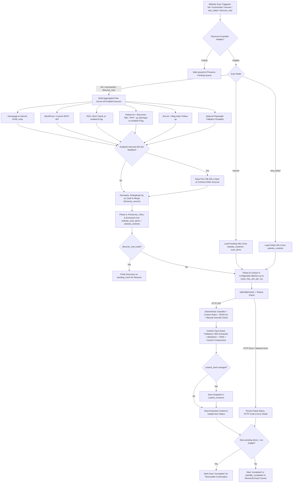
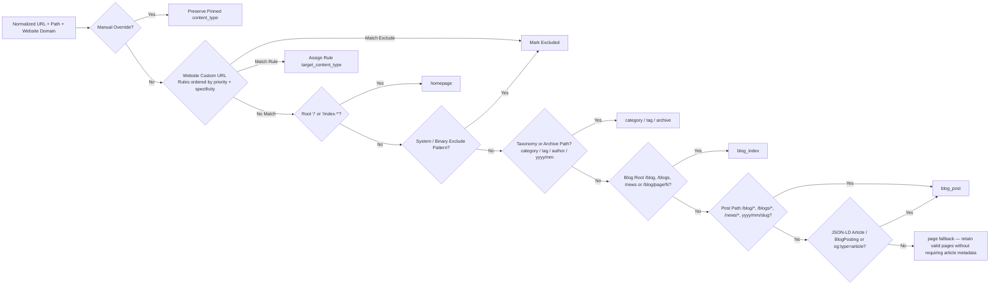
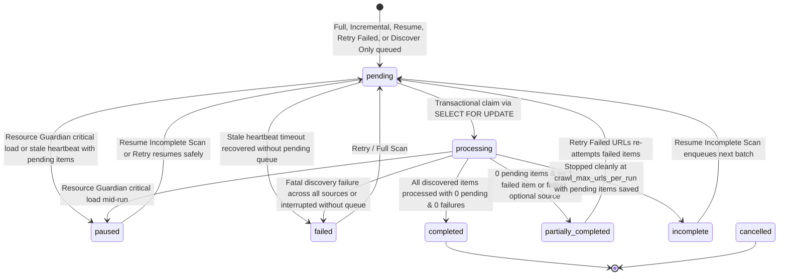

# ContentHub AI — Architecture

## 1. Architectural Style

ContentHub AI uses a **modular monolith** architecture paired with **separate Python background execution** (Phase 2/2.1 detached scan executor & scheduled CLI; full persistent job worker in Phase 6). It runs safely alongside production websites on a single aaPanel Linux server (`Asia/Manila` default display timezone) using existing MySQL without Redis, Celery, SQLite, or Docker requirements.

## 2. Three Independent Components

```text
                       ┌──────────────────────────────┐
                       │    Nginx (aaPanel Reverse    │
                       │    Proxy / Private Access)   │
                       └───────┬──────────────┬───────┘
                               │ /            │ /api/
                               ▼              ▼
             ┌──────────────────────┐   ┌──────────────────────────┐
             │  1. Nuxt 4 Frontend  │   │  2. FastAPI Backend API  │
             │  (PM2, :3100, TS)    │──▶│  (Supervisor, :8100)     │
             └──────────────────────┘   └────────────┬─────────────┘
                                                     │
                                                     │ SQLAlchemy + PyMySQL
                                                     │ (pool=3, overflow=2)
                                                     ▼
                                        ┌──────────────────────────┐
                                        │  Existing aaPanel MySQL  │
                                        │  (InnoDB, utf8mb4,       │
                                        │   FULLTEXT, Scan Items)  │
                                        └────────────▲─────────────┘
                                                     │
                                                     │ Row-locked claiming &
                                                     │ MySQL advisory locks
                                                     ▼
                                        ┌──────────────────────────┐
                                        │ 3. Python Background     │
                                        │    Executor & Worker     │
                                        │ (Phase 2.1 CLI + Phase 6)│
                                        └──────────────────────────┘
```

1. **Nuxt 4 Frontend (`frontend/` — Active Phases 1–2.1):** Desktop-first administrative dashboard built with Nuxt 4 (`app/` directory), TypeScript, Tailwind CSS v4, Nuxt UI v4, Pinia, and Lucide Icons. Employs a simplified **Website-Centric** workspace (no standalone `/brands` section), Settings-managed Website Categories, a 5-tab Website Detail Console, and a Universal Content Library with live tab counts.
2. **FastAPI Backend (`backend/` — Active Phases 1–2.1):** Python 3.12 REST API handling auth, CSRF, Settings/Categories, Website + merged Brand management, URL Rules, Discovery Sources, Content Library & Revisions, and Media assets.
3. **Python Background Executor & Worker (`backend/app/cli.py`, `backend/workers/`):** Non-blocking detached scan execution (`run-scan --scan-id`) and Cron scheduler (`run-due-scans`) with MySQL advisory locking, batched checkpoints, stale recovery, and `psutil` Resource Guardian deferral.

## 3. Website-Centric Aggregated Multi-Source Discovery *(Phase 2.1)*



## 4. Deterministic URL Classification Priority *(Phase 2.1)*



## 5. Website Scan Lifecycle *(Phase 2.1 State Diagram)*



## 6. Backend Internal Layering

```text
backend/app/
├── main.py            # App factory, CORS, security headers, middleware, router mounting
├── config.py          # Pydantic Settings loaded from .env (Phases 1–2.1)
├── database.py        # SQLAlchemy 2 engine, pool configuration, MySQL health/version probe
├── cli.py             # CLI: check-db, init-admin, run-scan, run-due-scans
├── core/              # Argon2id, Fernet, sessions, CSRF, rate limit, redaction, deps
├── models/            # Phase 1 (4) + Phase 2.1 (9) = 13 SQLAlchemy InnoDB/utf8mb4 models
├── schemas/           # Pydantic v2 API request & response contracts (category, website, content, media, dashboard)
├── repositories/      # Protocol + SQLAlchemy repositories (Phase 1 & Phase 2.1)
├── services/
│   ├── auth_service.py, settings_service.py, dashboard_service.py
│   ├── category_service.py, website_service.py, scan_executor.py, content_service.py, media_service.py
│   ├── monitoring/    # Live psutil Resource Guardian & health checks
│   ├── scanner/       # Aggregated discovery adapters + classifier + security (15 modules)
│   ├── content/       # Content-type-aware Trafilatura/BS4/Markdownify/YAKE/RapidFuzz/Pillow (9 modules)
│   └── ai/, seo/, social/, editorial/, publishers/, scheduler/, analytics/ (Phases 3–6 stubs)
└── routers/           # Lightweight FastAPI HTTP routers
```
