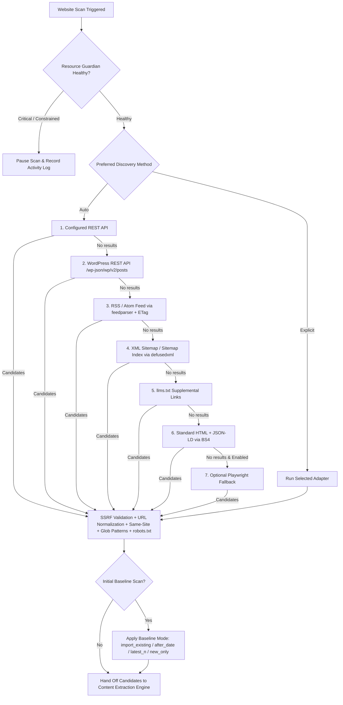
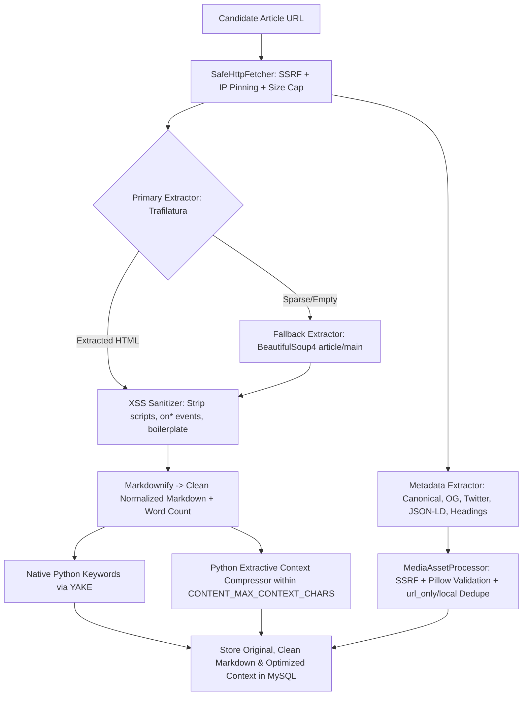
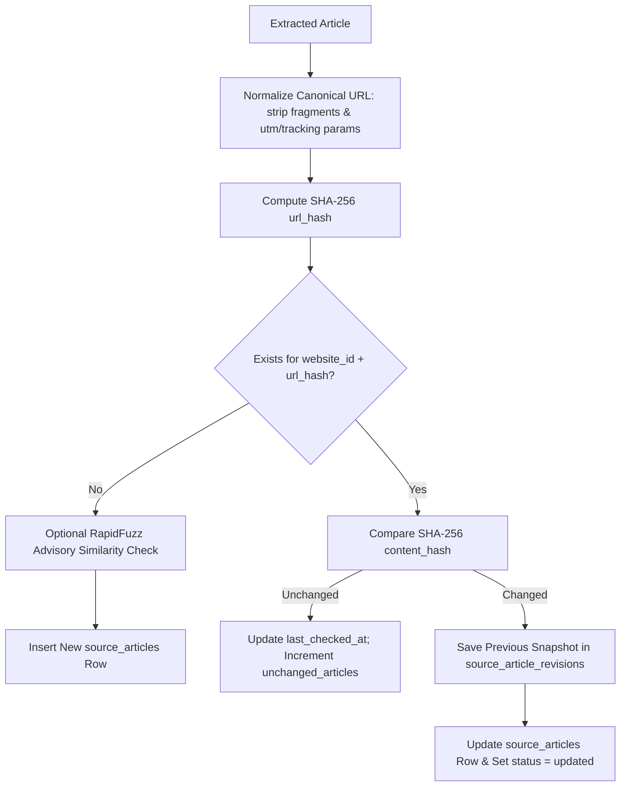
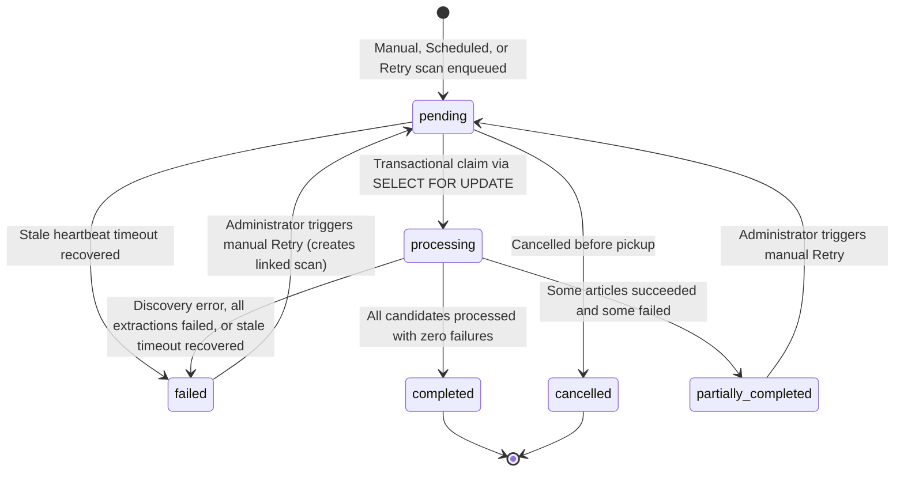

# ContentHub AI — Architecture

## 1. Architectural Style

ContentHub AI uses a **modular monolith** architecture paired with **separate Python background execution** (Phase 2 detached scan executor & scheduled CLI; full persistent job worker in Phase 6). It avoids microservices, Redis, Celery, and additional database servers so it runs safely alongside production websites on a single aaPanel Linux server (16 cores, 31 GB RAM, `Asia/Manila` timezone, PHP 0 additional monthly cost target).

## 2. Three Independent Components

```text
                       ┌──────────────────────────────┐
                       │    Nginx (aaPanel Reverse    │
                       │    Proxy / Private Access)   │
                       └───────┬──────────────┬───────┘
                               │ /            │ /api/
                               ▼              ▼
             ┌──────────────────────┐   ┌──────────────────────────┐
             │  1. Nuxt 4 Frontend  │   │  2. FastAPI Backend API  │
             │  (PM2, :3100, TS)    │──▶│  (Supervisor, :8100)     │
             └──────────────────────┘   └────────────┬─────────────┘
                                                     │
                                                     │ SQLAlchemy + PyMySQL
                                                     │ (pool=3, overflow=2)
                                                     ▼
                                        ┌──────────────────────────┐
                                        │  Existing aaPanel MySQL  │
                                        │  (InnoDB, utf8mb4,       │
                                        │   FULLTEXT, Durable Logs)│
                                        └────────────▲─────────────┘
                                                     │
                                                     │ Row-locked claiming &
                                                     │ MySQL advisory locks
                                                     ▼
                                        ┌──────────────────────────┐
                                        │ 3. Python Background     │
                                        │    Executor & Worker     │
                                        │  (Phase 2 CLI + Phase 6) │
                                        └──────────────────────────┘
```

1. **Nuxt 4 Frontend (`frontend/` — Active Phases 1–2):** Desktop-first administrative dashboard built with Nuxt 4 (`app/` directory), TypeScript, Tailwind CSS v4, Nuxt UI v4, Pinia, and Lucide Icons. Communicates strictly over `/api/v1/...` REST endpoints.
2. **FastAPI Backend (`backend/` — Active Phases 1–2):** Python 3.12 REST API handling authentication, authorization, CSRF verification, validation, Brand/Website/Content Library/Media APIs, and MySQL persistence. Never executes website scanning inline inside web requests.
3. **Python Background Executor & Worker (`backend/app/cli.py`, `backend/workers/`):**
   - *Implemented (Phase 2):* Non-blocking detached scan execution (`python -m app.cli run-scan --scan-id <id>`) and aaPanel Cron scheduled scanning (`python -m app.cli run-due-scans`) protected by MySQL row-level locking (`SELECT ... FOR UPDATE`), MySQL advisory locks (`GET_LOCK`), stale heartbeat recovery, and the `psutil` Resource Guardian.
   - *Planned (Phase 6):* Full persistent MySQL-backed job queue (`publishing_jobs`) and Supervisor-managed worker process.

> **AI & Content Processing Policy:** Native Python handles content extraction, extractive summarization, keyword extraction, and token optimization. **Google Gemini API** (Phase 3+) is the **sole** AI generation provider. No container runtime or secondary AI agent framework is required.

## 3. Website Discovery Workflow *(Implemented — Phase 2)*



## 4. Content Extraction & Token Optimization Workflow *(Implemented — Phase 2, Zero AI Calls)*



## 5. Duplicate Detection & Revision Workflow *(Implemented — Phase 2)*



## 6. Website Scan Lifecycle *(Implemented — Phase 2)*



## 7. Backend Internal Layering

```text
backend/app/
├── main.py            # App factory, CORS, security headers, middleware, router mounting
├── config.py          # Pydantic Settings loaded from .env (Phases 1–2)
├── database.py        # SQLAlchemy 2 engine, pool configuration, MySQL health/version probe
├── cli.py             # CLI: check-db, init-admin, run-scan, run-due-scans
├── core/              # Argon2id, Fernet, sessions, CSRF, rate limit, redaction, deps
├── models/            # Phase 1 (4 tables) + Phase 2 (6 tables) SQLAlchemy InnoDB/utf8mb4 models
├── schemas/           # Pydantic v2 API request & response contracts
├── repositories/      # Protocol + SQLAlchemy repositories (Phase 1 & Phase 2)
├── services/
│   ├── auth_service.py, settings_service.py, dashboard_service.py
│   ├── brand_service.py, website_service.py, scan_executor.py, article_service.py, media_service.py
│   ├── monitoring/    # Live psutil Resource Guardian & health checks
│   ├── scanner/       # Phase 2 SSRF-safe modular discovery adapters (14 modules)
│   ├── content/       # Phase 2 Trafilatura/BS4/Markdownify/YAKE/RapidFuzz/Pillow (9 modules)
│   └── ai/, seo/, social/, editorial/, publishers/, scheduler/, analytics/ (Phases 3–6 stubs)
└── routers/           # Lightweight FastAPI HTTP routers
```
