# ContentHub AI — Database Architecture & Schema Specification

This document defines the complete MySQL database architecture for **ContentHub AI**, verified against the implemented Phase 1 SQLAlchemy ORM models and Alembic migration (`20261126_0001`), and specifies the proposed incremental schemas for Phases 2–6.

---

## 1. Database Engine, Standards & Operational Policy

| Requirement | Standard |
|---|---|
| **Database Service** | Existing aaPanel MySQL service only (no separate DB installation) |
| **Storage Engine** | `InnoDB` on every table (transactional integrity, row-level locking, FKs) |
| **Charset & Collation** | `utf8mb4` / `utf8mb4_unicode_ci` on database, tables, and text columns |
| **Full-Text Search** | MySQL native `FULLTEXT` indexes on supported InnoDB text columns |
| **ORM & Driver** | SQLAlchemy 2.x + PyMySQL (`mysql+pymysql://...?charset=utf8mb4`) |
| **Migrations** | Alembic (`backend/migrations/`) — applied incrementally per roadmap phase |
| **Runtime Account** | Dedicated least-privilege MySQL user (`contenthub_user`) — **never** `root` |
| **Timestamps** | Stored in UTC (`DATETIME`); formatted to `APP_TIMEZONE` (`Asia/Manila` default) in UI |
| **Credentials at Rest** | Fernet-encrypted (`cryptography.fernet.Fernet`); `APP_ENCRYPTION_KEY` stored outside DB |
| **Prohibited Stores** | SQLite (including tests), PostgreSQL, MongoDB, Redis, Celery brokers, vector DBs |

### Conservative Connection Pooling Defaults

Shared aaPanel hosting runs production websites alongside ContentHub AI. Every application process uses conservative SQLAlchemy pooling:

```ini
DB_HOST=127.0.0.1
DB_PORT=3306
DB_NAME=contenthub_ai
DB_USER=contenthub_user
DB_POOL_SIZE=3
DB_MAX_OVERFLOW=2
DB_POOL_RECYCLE=1800
DB_CONNECT_TIMEOUT=5
```

`pool_pre_ping=True` is always enabled so MySQL `wait_timeout` recycling does not leave dead sockets in the pool.

### MySQL Version Verification Requirement

Before using version-dependent SQL features (notably `SELECT ... FOR UPDATE SKIP LOCKED` in Phase 6 job claiming, which requires MySQL >= 8.0.1 or MariaDB >= 10.6, and InnoDB `FULLTEXT` indexes), verify the target instance via:

```bash
cd backend && source .venv/bin/activate
python -m app.cli check-db
```

- **Local Development Verification (2026-11-26):** Verified `aapanel-mysql-2` (`127.0.0.1:3309`) running **MySQL `8.0.45`**, `character_set_database = utf8mb4`, `InnoDB = True`.
- **Legacy Fallback Note:** If a target aaPanel MySQL server is 5.7.x (lacking `SKIP LOCKED`), Phase 6 claiming falls back to an atomic `UPDATE ... WHERE status IN ('queued','retrying') AND available_at <= UTC_TIMESTAMP() ORDER BY priority ASC, available_at ASC, id ASC LIMIT 1` with a unique `locked_by` claim token followed by `SELECT` of the claimed row.

---

## 2. Implemented Schema Verification (Phases 1 & 2.1 vs Proposed Phases 3–6)

Every implemented Phase 1 & Phase 2.1 SQLAlchemy model in `backend/app/models/` was verified against Alembic revisions `20261126_0001`, `20261126_0002`, and `20261127_0003` — including live MySQL `8.0.45` Phase 2->2.1 data preservation migration (`upgrade head -> downgrade 20261126_0002 -> upgrade head`) and real SQLAlchemy CRUD tests on isolated `contenthub_ai_test`:

| Table | Status | ORM Model | Migration Revision | Drift Check |
|---|---|---|---|---|
| `users` | **Implemented (Phase 1)** | `app/models/user.py` (`User`) | `20261126_0001` | Exact match |
| `sessions` | **Implemented (Phase 1)** | `app/models/session.py` (`AdminSession`) | `20261126_0001` | Exact match |
| `application_settings` | **Implemented (Phase 1)** | `app/models/setting.py` (`ApplicationSetting`) | `20261126_0001` | Exact match |
| `activity_logs` | **Implemented (Phase 1)** | `app/models/activity_log.py` (`ActivityLog`) | `20261126_0001` | Exact match |
| `website_categories` | **Implemented (Phase 2.1)** | `app/models/website_category.py` (`WebsiteCategory`) | `20261127_0003` | Exact match (Live MySQL verified) |
| `websites` | **Implemented (Phase 2 / 2.1)** | `app/models/website.py` (`Website`) | `20261126_0002` + `20261127_0003` | Exact match (merged brand fields, Live MySQL verified) |
| `website_discovery_sources` | **Implemented (Phase 2.1)** | `app/models/website_discovery_source.py` (`WebsiteDiscoverySource`) | `20261127_0003` | Exact match (Live MySQL verified) |
| `website_url_rules` | **Implemented (Phase 2.1)** | `app/models/website_url_rule.py` (`WebsiteUrlRule`) | `20261127_0003` | Exact match (Live MySQL verified) |
| `media_assets` | **Implemented (Phase 2 / 2.1)** | `app/models/media_asset.py` (`MediaAsset`) | `20261126_0002` + `20261127_0003` | Exact match (`website_id` ownership, Live MySQL verified) |
| `website_contents` | **Implemented (Phase 2 / 2.1)** | `app/models/website_content.py` (`WebsiteContent`) | `20261126_0002` + `20261127_0003` | Exact match (renamed + FULLTEXT, Live MySQL verified) |
| `content_revisions` | **Implemented (Phase 2 / 2.1)** | `app/models/content_revision.py` (`ContentRevision`) | `20261126_0002` + `20261127_0003` | Exact match (Live MySQL verified) |
| `website_scan_logs` | **Implemented (Phase 2 / 2.1)** | `app/models/website_scan_log.py` (`WebsiteScanLog`) | `20261126_0002` + `20261127_0003` | Exact match (Live MySQL verified) |
| `website_scan_items` | **Implemented (Phase 2.1)** | `app/models/website_scan_item.py` (`WebsiteScanItem`) | `20261127_0003` | Exact match (Live MySQL verified) |

### Master Architecture Inventory (13 Implemented + 20 Proposed)

Phases 1 and 2.1 (13 tables) are **Implemented**. Tables in Phases 3–6 (20 tables) remain **Proposed specifications only** and are website-centric (`websites.id` / `website_contents.id`), to be migrated incrementally by phase.

| # | Table | Module | Phase | Status | Deletion Policy | Default Retention |
|---|---|---|---|---|---|---|
| 1 | `users` | Auth & Settings | Phase 1 | **Implemented** | Deactivate (`is_active=0`), avoid hard delete | Permanent |
| 2 | `sessions` | Auth & Settings | Phase 1 | **Implemented** | Revoke (`revoked_at`), prune expired | 30 days after expiry/revocation |
| 3 | `application_settings` | Auth & Settings | Phase 1 | **Implemented** | Upsert / reset to default | Permanent |
| 4 | `activity_logs` | Auth & Settings | Phase 1 | **Implemented** | Immutable append-only | 180 days (configurable) |
| 5 | `website_categories` | Websites & Categories | Phase 2.1 | **Implemented** | Archive (`is_archived=1`); block delete if in use | Until manually purged |
| 6 | `websites` | Websites & Categories | Phase 2.1 | **Implemented** | Archive (`status=archived`); block delete if content exists | Until manually purged |
| 7 | `website_discovery_sources` | Scanner & Sources | Phase 2.1 | **Implemented** | Cascade on website hard purge; toggle `is_enabled` | Permanent |
| 8 | `website_url_rules` | Scanner & Rules | Phase 2.1 | **Implemented** | Cascade on website hard purge | Permanent |
| 9 | `website_scan_logs` | Websites & Scanner | Phase 2.1 | **Implemented** | Append-only, cascade on website hard purge | 90 days |
| 10 | `website_scan_items` | Websites & Scanner | Phase 2.1 | **Implemented** | Cascade on scan log purge | 90 days |
| 11 | `website_contents` | Content & Media | Phase 2.1 | **Implemented** | Soft-exclude (`is_excluded=1`) or archive (`status=archived`) | Until manually purged |
| 12 | `content_revisions` | Content & Media | Phase 2.1 | **Implemented** | Cascade on content hard purge | Keep last 10 revisions or 180 days |
| 13 | `media_assets` | Content & Media | Phase 2.1 | **Implemented** | Set null on website/content delete; orphan sweep | 30 days after orphan |
| 11 | `ai_providers` | Gemini AI & Cache | Phase 3 | Proposed | Deactivate (`is_active=0`) | Permanent |
| 12 | `prompt_templates` | Gemini AI & Cache | Phase 3 | Proposed | Versioned deactivate (`is_active=0`) | Permanent for cache/audit replay |
| 13 | `ai_response_cache` | Gemini AI & Cache | Phase 3 | Proposed | Hard delete on TTL expiry/invalidation | 30 days TTL (configurable) |
| 14 | `ai_generation_logs` | Gemini AI & Cache | Phase 3 | Proposed | Immutable append-only | 365 days (quota & cost history) |
| 15 | `platforms` | Social & Accounts | Phase 4 | Proposed | Seeded reference catalog (`is_enabled`) | Permanent |
| 16 | `connected_accounts` | Social & Accounts | Phase 4 | Proposed | Soft delete (`deleted_at`), wipe secrets | Until manually purged |
| 17 | `social_posts` | Social & Accounts | Phase 4 | Proposed | Soft delete (`deleted_at`) | Until manually purged |
| 18 | `publishing_logs` | Social & Accounts | Phase 4 | Proposed | Immutable append-only | 365 days (duplicate audit trail) |
| 19 | `keyword_research` | Editorial & Articles | Phase 5 | Proposed | Hard delete or archive (`status`) | 365 days |
| 20 | `editorial_plans` | Editorial & Articles | Phase 5 | Proposed | Archive (`status=archived`) | Permanent |
| 21 | `editorial_topics` | Editorial & Articles | Phase 5 | Proposed | Soft delete (`deleted_at`) | Until manually purged |
| 22 | `editorial_articles` | Editorial & Articles | Phase 5 | Proposed | Soft delete (`deleted_at`) | Until manually purged |
| 23 | `editorial_article_revisions` | Editorial & Articles | Phase 5 | Proposed | Cascade on hard purge | Keep last 25 revisions or 365 days |
| 24 | `publishing_schedules` | Schedules & Queue | Phase 4/6 | Proposed | Cancel/archive (`status`) | 365 days |
| 25 | `publishing_jobs` | Schedules & Queue | Phase 6 | Proposed | Retain history, batch prune terminal rows | 90 days (failed: 180 days) |
| 26 | `automation_rules` | Schedules & Queue | Phase 6 | Proposed | Disable (`is_enabled=0`) or soft delete | Until manually purged |
| 27 | `scheduled_tasks` | Schedules & Queue | Phase 6 | Proposed | Disable (`is_enabled=0`) | Permanent |
| 28 | `analytics_records` | Analytics & Ops | Phase 6 | Proposed | Upsert daily rollups | 730 days (2 years) |
| 29 | `resource_metrics` | Analytics & Ops | Phase 6 | Proposed | Append-only time-series, batch prune | 30 days raw samples |
| 30 | `backup_records` | Analytics & Ops | Phase 6 | Proposed | Mark `expired` when dump file deleted | Metadata 365 days; files 14 days default |

---

## 3. Modular Database Architecture & Mermaid ERD Diagrams

### 3.1 Authentication and Settings *(Implemented — Phase 1, Migration `20261126_0001`)*

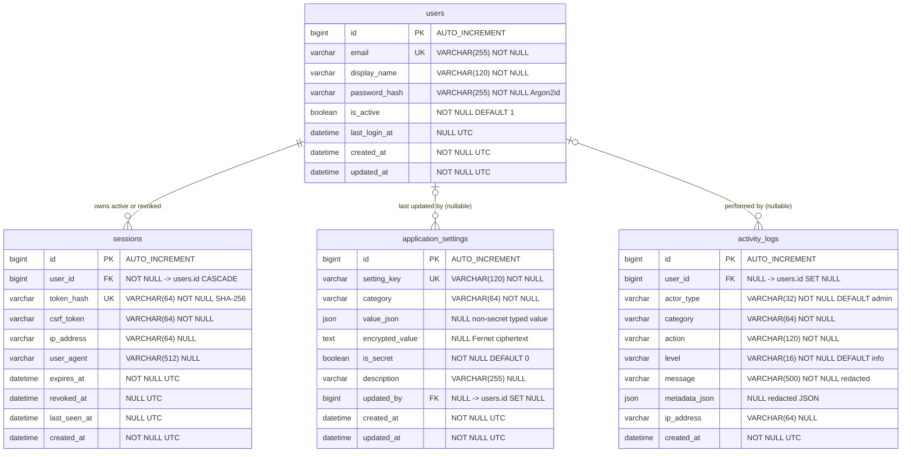

#### Table Constraints, Indexes & Policies (Module 3.1 — Implemented)

- **`users`**:
  - **PK:** `id` (`BIGINT AUTO_INCREMENT`)
  - **Unique:** `uq_users_email (email)`
  - **Deletion & Retention:** Single-administrator model; deactivate via `is_active = 0` rather than hard deletion so foreign-key audit references remain clear.
- **`sessions`**:
  - **PK:** `id`
  - **FK:** `fk_sessions_user_id_users (user_id -> users.id ON DELETE CASCADE)` (non-nullable)
  - **Unique:** `uq_sessions_token_hash (token_hash)` — raw session cookie token is never stored.
  - **Indexes:** `ix_sessions_user_id (user_id)`, `ix_sessions_expires_at (expires_at)`
  - **Deletion & Retention:** Logout sets `revoked_at`; Phase 6 cleanup job purges expired/revoked sessions older than 30 days.
- **`application_settings`**:
  - **PK:** `id`
  - **FK:** `fk_application_settings_updated_by_users (updated_by -> users.id ON DELETE SET NULL)` (nullable for CLI/system defaults)
  - **Unique:** `uq_application_settings_setting_key (setting_key)`
  - **Indexes:** `ix_application_settings_category (category)`
  - **Deletion & Retention:** Upsert in-place; when `is_secret = 1`, `value_json` stays `NULL` and ciphertext lives in `encrypted_value`.
- **`activity_logs`**:
  - **PK:** `id`
  - **FK:** `fk_activity_logs_user_id_users (user_id -> users.id ON DELETE SET NULL)` (nullable for anonymous failed logins, CLI, cron, or background worker actors)
  - **Indexes:** `ix_activity_logs_category (category)`, `ix_activity_logs_level (level)`, `ix_activity_logs_created_at (created_at)`
  - **Deletion & Retention:** Append-only immutable audit records (redacted before write); retain 180 days by default before batched archival/pruning.

---

### 3.2 Website Categories, Brand Profiles, Discovery Sources & Scans *(Implemented — Phase 2.1, Migration `20261127_0003`)*

```mermaid
erDiagram
    website_categories |o--o{ websites : "categorizes website (nullable)"
    websites ||--o{ website_discovery_sources : "tracks endpoints & ETags"
    website_discovery_sources |o--o{ website_discovery_sources : "child sitemap tree"
    websites ||--o{ website_url_rules : "custom classification rules"
    websites ||--o{ website_scan_logs : "records batched scan runs"
    website_scan_logs ||--o{ website_scan_items : "tracks per-URL outcome"
    website_contents |o--o{ website_scan_items : "links extracted row"

    website_categories {
        bigint id PK "AUTO_INCREMENT"
        varchar name UK "VARCHAR(100) NOT NULL"
        varchar slug UK "VARCHAR(120) NOT NULL"
        varchar description "VARCHAR(255) NULL"
        boolean is_archived "NOT NULL DEFAULT 0"
        int sort_order "NOT NULL DEFAULT 100"
        datetime created_at "NOT NULL UTC"
        datetime updated_at "NOT NULL UTC"
    }

    websites {
        bigint id PK "AUTO_INCREMENT"
        bigint category_id FK "NULL -> website_categories.id SET NULL"
        varchar name "VARCHAR(150) NOT NULL"
        varchar brand_name "VARCHAR(150) NOT NULL"
        varchar brand_slug "VARCHAR(150) NULL"
        varchar logo_url "VARCHAR(500) NULL"
        text brand_description "TEXT NULL"
        varchar target_audience "VARCHAR(255) NULL"
        varchar target_country "VARCHAR(64) NULL"
        varchar primary_language "VARCHAR(32) NOT NULL DEFAULT en"
        json secondary_languages "NULL"
        varchar tone "VARCHAR(120) NULL"
        json target_keywords "NULL"
        json restricted_keywords "NULL"
        json default_hashtags "NULL"
        varchar default_cta "VARCHAR(255) NULL"
        text writing_guidelines "TEXT NULL"
        text ai_instructions "TEXT NULL"
        varchar domain UK "VARCHAR(255) NOT NULL normalized"
        varchar website_type "VARCHAR(32) NOT NULL wp/nuxt/nextjs/php/static/other/rest"
        varchar discovery_method "VARCHAR(32) NOT NULL DEFAULT auto"
        boolean single_source_only "NOT NULL DEFAULT 0"
        varchar rss_url "VARCHAR(500) NULL"
        varchar sitemap_url "VARCHAR(500) NULL"
        varchar llms_url "VARCHAR(500) NULL"
        varchar api_endpoint "VARCHAR(500) NULL"
        json article_url_patterns "NULL"
        json excluded_url_patterns "NULL"
        int scan_interval_minutes "NOT NULL DEFAULT 1440"
        int crawl_batch_size "NOT NULL DEFAULT 100"
        int crawl_max_urls_per_run "NOT NULL DEFAULT 1000"
        boolean auto_scan "NOT NULL DEFAULT 1"
        boolean auto_generate "NOT NULL DEFAULT 0"
        boolean initial_scan_completed "NOT NULL DEFAULT 0"
        varchar baseline_mode "VARCHAR(32) NOT NULL"
        datetime baseline_after_date "NULL UTC"
        int baseline_limit "NULL"
        datetime last_scanned_at "NULL UTC"
        datetime last_successful_scan_at "NULL UTC"
        datetime next_scan_at "NULL UTC"
        varchar status "VARCHAR(32) NOT NULL active/paused/error/archived"
        datetime created_at "NOT NULL UTC"
        datetime updated_at "NOT NULL UTC"
    }

    website_discovery_sources {
        bigint id PK "AUTO_INCREMENT"
        bigint website_id FK "NOT NULL -> websites.id CASCADE"
        bigint parent_source_id FK "NULL -> website_discovery_sources.id SET NULL"
        varchar source_type "VARCHAR(32) NOT NULL homepage/rss/sitemap/wordpress/rest_api/llms_txt"
        varchar endpoint_url "VARCHAR(1000) NOT NULL"
        varchar endpoint_hash "VARCHAR(64) NOT NULL SHA-256"
        boolean is_enabled "NOT NULL DEFAULT 1"
        varchar etag "VARCHAR(255) NULL per endpoint"
        varchar last_modified_header "VARCHAR(128) NULL per endpoint"
        int last_status_code "NULL"
        int last_urls_found "NOT NULL DEFAULT 0"
        datetime last_checked_at "NULL UTC"
        datetime last_success_at "NULL UTC"
        text last_error "TEXT NULL"
        datetime created_at "NOT NULL UTC"
        datetime updated_at "NOT NULL UTC"
    }

    website_url_rules {
        bigint id PK "AUTO_INCREMENT"
        bigint website_id FK "NOT NULL -> websites.id CASCADE"
        varchar pattern "VARCHAR(255) NOT NULL"
        varchar target_content_type "VARCHAR(32) NOT NULL"
        varchar match_mode "VARCHAR(24) NOT NULL prefix/glob/exact/regex"
        int priority "NOT NULL DEFAULT 100"
        boolean is_enabled "NOT NULL DEFAULT 1"
        varchar notes "VARCHAR(255) NULL"
        datetime created_at "NOT NULL UTC"
        datetime updated_at "NOT NULL UTC"
    }

    website_scan_logs {
        bigint id PK "AUTO_INCREMENT"
        bigint website_id FK "NOT NULL -> websites.id CASCADE"
        varchar scan_method "VARCHAR(64) NOT NULL"
        varchar scan_mode "VARCHAR(32) NOT NULL full/incremental/resume/retry_failed/discover_only"
        varchar trigger_type "VARCHAR(32) NOT NULL manual/scheduled/retry"
        int urls_found "NOT NULL DEFAULT 0"
        int articles_processed "NOT NULL DEFAULT 0"
        int urls_pending_extraction "NOT NULL DEFAULT 0"
        int new_articles "NOT NULL DEFAULT 0"
        int updated_articles "NOT NULL DEFAULT 0"
        int unchanged_articles "NOT NULL DEFAULT 0"
        int skipped_articles "NOT NULL DEFAULT 0"
        int failed_articles "NOT NULL DEFAULT 0"
        int excluded_count "NOT NULL DEFAULT 0"
        int homepage_count "NOT NULL DEFAULT 0"
        int page_count "NOT NULL DEFAULT 0"
        int blog_post_count "NOT NULL DEFAULT 0"
        int other_count "NOT NULL DEFAULT 0"
        varchar current_source "VARCHAR(120) NULL"
        varchar current_url "VARCHAR(1000) NULL"
        json discovered_sitemaps_json "NULL"
        json sources_completed_json "NULL"
        json sources_failed_json "NULL"
        varchar status "VARCHAR(32) NOT NULL pending/processing/completed/partially_completed/incomplete/paused/failed/cancelled"
        text error_message "TEXT NULL redacted"
        int duration_ms "NULL"
        datetime heartbeat_at "NULL UTC stale recovery"
        datetime started_at "NULL UTC"
        datetime completed_at "NULL UTC"
        datetime created_at "NOT NULL UTC"
    }

    website_scan_items {
        bigint id PK "AUTO_INCREMENT"
        bigint scan_log_id FK "NOT NULL -> website_scan_logs.id CASCADE"
        bigint website_id FK "NOT NULL -> websites.id CASCADE"
        bigint content_id FK "NULL -> website_contents.id SET NULL"
        varchar url "VARCHAR(1000) NOT NULL"
        varchar normalized_url "VARCHAR(1000) NOT NULL"
        varchar url_hash "VARCHAR(64) NOT NULL SHA-256"
        varchar content_type "VARCHAR(32) NOT NULL"
        json discovery_sources "NULL"
        varchar discovered_title "VARCHAR(500) NULL"
        datetime discovered_published_at "NULL"
        datetime discovered_modified_at "NULL"
        varchar status "VARCHAR(32) NOT NULL pending/new/updated/unchanged/failed/excluded"
        int http_status "NULL"
        varchar failure_reason "VARCHAR(120) NULL"
        varchar error_detail "VARCHAR(500) NULL"
        datetime processed_at "NULL UTC"
        datetime created_at "NOT NULL UTC"
        datetime updated_at "NOT NULL UTC"
    }
```

#### Table Constraints, Indexes & Policies (Module 3.2 — Implemented Phase 2.1)

- **`website_categories`**: PK `id`; Unique `uq_website_categories_slug`, `uq_website_categories_name`. Deletion blocked (`409 Conflict`) while assigned websites exist.
- **`websites`**: PK `id`; FK `category_id -> website_categories.id ON DELETE SET NULL`; Unique `uq_websites_domain (domain)`; Indexes `ix_websites_category_id`, `ix_websites_domain`, `ix_websites_status`, `ix_websites_next_scan_at`. Owns merged brand identity (`brand_name`, `brand_slug`, `logo_url`, `writing_guidelines`, `ai_instructions`, languages, keywords, hashtags, CTA).
- **`website_discovery_sources`**: PK `id`; Unique `uq_website_discovery_sources_ep (website_id, endpoint_hash)`. Stores isolated per-endpoint `etag` and `last_modified_header` so 304 responses are completely decoupled across endpoints.
- **`website_url_rules`**: PK `id`; Index `ix_website_url_rules_site_prio (website_id, priority)`.
- **`website_scan_logs` & `website_scan_items`**: Durable per-URL audit log (`uq_website_scan_items_scan_url`) backing resumable batching, exact count reconciliation, and failure inspection.

---

### 3.3 Universal Content Library and Media Assets *(Implemented — Phase 2.1, Migration `20261127_0003`)*

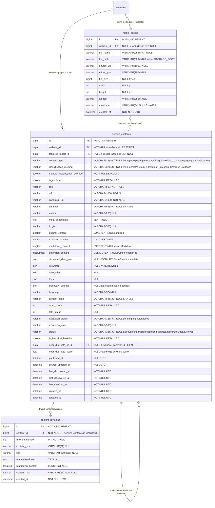

#### Table Constraints, Indexes & Policies (Module 3.3 — Implemented Phase 2.1)

- **`media_assets`**: PK `id`; FK `fk_media_assets_website_id_websites (website_id -> websites.id ON DELETE SET NULL)`; Indexes `ix_media_assets_website_id`, `ix_media_assets_checksum`.
- **`website_contents`**: PK `id`; FKs `website_id -> websites.id ON DELETE RESTRICT`, `featured_media_id -> media_assets.id ON DELETE SET NULL`, `near_duplicate_of_id -> website_contents.id ON DELETE SET NULL`; Unique `uq_website_contents_site_url_hash (website_id, url_hash)`; Indexes `ix_website_contents_site_type`, `ix_website_contents_extract_status`, `ix_website_contents_status`, and MySQL `FULLTEXT INDEX ft_website_contents_search (title, meta_description, markdown_content)`.
- **`content_revisions`**: PK `id`; FK `content_id -> website_contents.id ON DELETE CASCADE`; Unique `uq_content_revisions_content_rev (content_id, revision_number)`.

---

### 3.4 Gemini AI Management and Response Caching *(Proposed — Phase 3)*

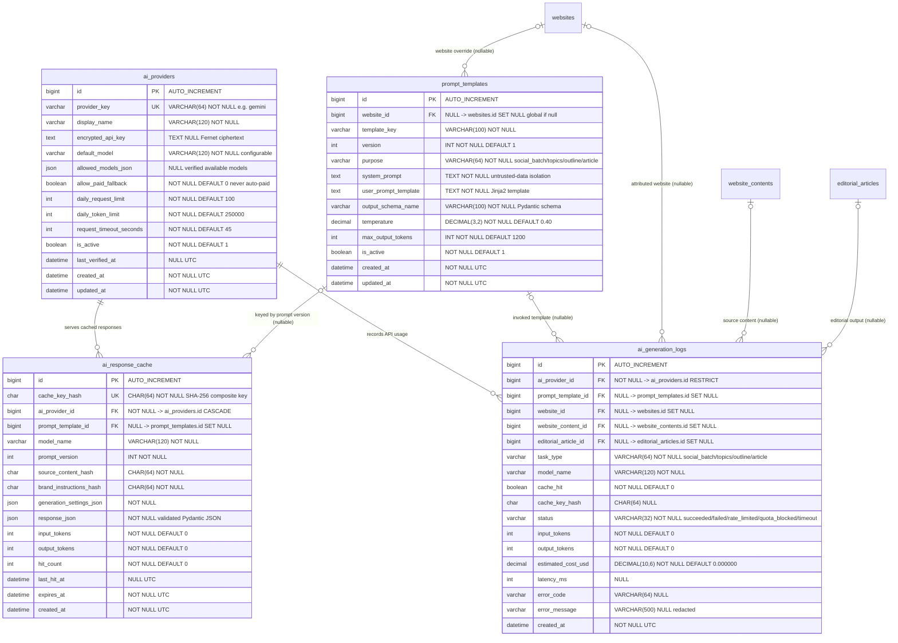

#### Table Constraints, Indexes & Policies (Module 3.4 — Proposed Phase 3)

- **AI Cache Key Composition (`ai_response_cache.cache_key_hash`):** SHA-256 computed deterministically from `(provider_key, model_name, template_key, prompt_version, canonical_generation_settings_json, brand_instructions_hash, source_content_hash)`.
- **`ai_providers`**:
  - **PK:** `id` | **Unique:** `uq_ai_providers_provider_key (provider_key)`
  - **Quota Protection:** `allow_paid_fallback` defaults to `0` so exhausting free-tier quotas transitions requests to `quota_blocked` rather than silently incurring spend.
- **`prompt_templates`**:
  - **PK:** `id` | **Unique:** `uq_prompt_templates_key_version_brand (template_key, version, brand_scope_key)` (or `brand_id` nullable with `brand_scope_key` defaulting to `'global'` so MySQL enforces uniqueness cleanly even when `brand_id IS NULL`).
  - **Deletion & Retention:** Versioned; deactivate older versions (`is_active = 0`) instead of deleting so `ai_generation_logs` stay auditable.
- **`ai_response_cache`**:
  - **PK:** `id` | **Unique:** `uq_ai_response_cache_key_hash (cache_key_hash)`
  - **Indexes:** `ix_ai_response_cache_expires_at (expires_at)`, `ix_ai_response_cache_source_hash (source_content_hash)`
  - **Retention:** Hard-deleted by scheduled `cache_cleanup` job once `expires_at < UTC_TIMESTAMP()` (30-day default TTL).
- **`ai_generation_logs`**:
  - **PK:** `id`
  - **Indexes:** `ix_ai_generation_logs_created_at (created_at)`, `ix_ai_generation_logs_provider_created (ai_provider_id, created_at)`, `ix_ai_generation_logs_brand_created (brand_id, created_at)`, `ix_ai_generation_logs_status (status)`
  - **Retention:** Immutable append-only; retained 365 days for quota enforcement and usage trend reporting.

---

### 3.5 Social Media and Connected Accounts *(Proposed — Phase 4)*

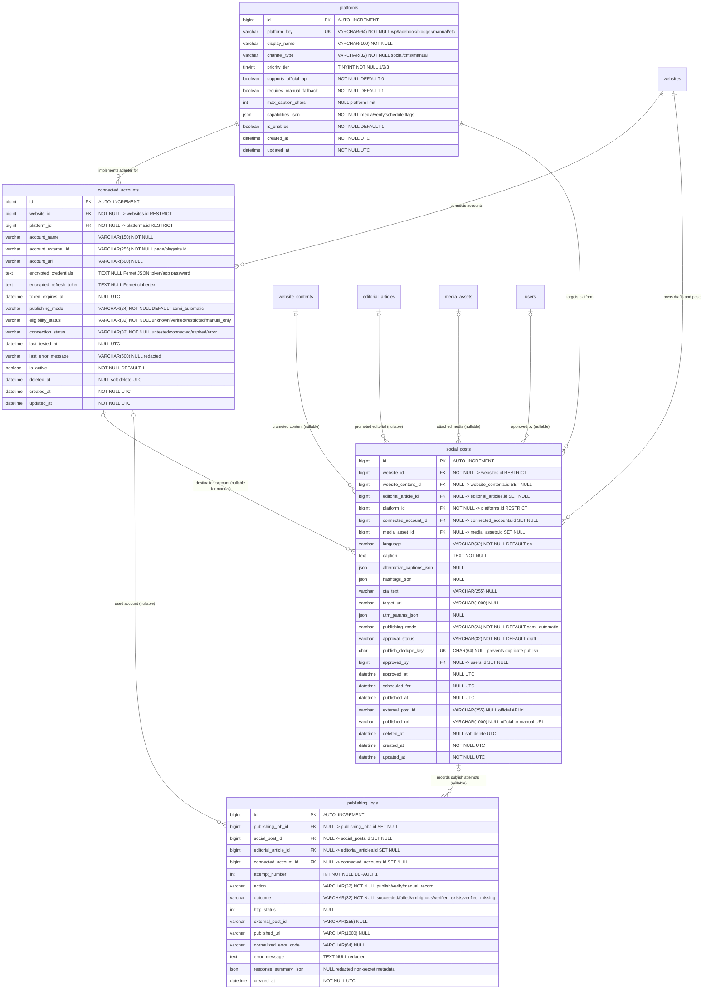

#### Table Constraints, Indexes & Policies (Module 3.5 — Proposed Phase 4)

- **`platforms`**:
  - **PK:** `id` | **Unique:** `uq_platforms_platform_key (platform_key)`
  - Seeded with Priority 1 (`wordpress`, `facebook`, `blogger`, `manual`), Priority 2 (`instagram`, `threads`, `linkedin`, `google_business_profile`, `devto`), and Priority 3 (`pinterest`, `custom_rest`, `x_manual`, `hashnode_manual`, `medium_manual`).
- **`connected_accounts`**:
  - **PK:** `id`
  - **Unique:** `uq_connected_accounts_brand_platform_ext (brand_id, platform_id, account_external_id)`
  - **Indexes:** `ix_connected_accounts_brand_active (brand_id, is_active, deleted_at)`
  - **Deletion & Retention:** Soft delete sets `deleted_at`, sets `is_active = 0`, and immediately clears `encrypted_credentials` and `encrypted_refresh_token` (`NULL`).
- **`social_posts`**:
  - **PK:** `id`
  - **Unique:** `uq_social_posts_publish_dedupe_key (publish_dedupe_key)` — deterministic hash of `(connected_account_id, source_article_id_or_editorial_id, content_fingerprint)` assigned when queued/approved so identical duplicate posts cannot publish twice to the same destination.
  - **Indexes:** `ix_social_posts_status_scheduled (approval_status, scheduled_for)`, `ix_social_posts_brand_platform (brand_id, platform_id)`, `ix_social_posts_source_article (source_article_id)`, `ix_social_posts_deleted_at (deleted_at)`
  - **Nullable Relationships:** `connected_account_id` is nullable to support pure **Manual** mode (copy/export without API credentials); `source_article_id` and `editorial_article_id` are nullable to allow standalone social posts.
- **`publishing_logs`**:
  - **PK:** `id`
  - **Indexes:** `ix_publishing_logs_social_post (social_post_id, created_at)`, `ix_publishing_logs_editorial_article (editorial_article_id, created_at)`, `ix_publishing_logs_job (publishing_job_id)`, `ix_publishing_logs_outcome (outcome, created_at)`
  - **Deletion & Retention:** Immutable append-only audit trail retained 365 days; never logs decrypted tokens or raw authorization headers.

---

### 3.6 Editorial Planning and Articles *(Proposed — Phase 5)*

```mermaid
erDiagram
    websites ||--o{ keyword_research : "researches keywords"
    websites ||--o{ editorial_plans : "organizes calendar plans"
    websites ||--o{ editorial_topics : "suggests topics"
    editorial_plans |o--o{ editorial_topics : "groups into plan (nullable)"
    keyword_research |o--o{ editorial_topics : "primary keyword (nullable)"
    websites ||--o{ editorial_articles : "authors articles"
    editorial_topics |o--o{ editorial_articles : "drafted from topic (nullable)"
    connected_accounts |o--o{ editorial_articles : "CMS publish target (nullable)"
    media_assets |o--o{ editorial_articles : "featured image (nullable)"
    editorial_articles ||--o{ editorial_article_revisions : "version history"

    keyword_research {
        bigint id PK "AUTO_INCREMENT"
        bigint website_id FK "NOT NULL -> websites.id RESTRICT"
        varchar keyword "VARCHAR(255) NOT NULL"
        char keyword_hash "CHAR(64) NOT NULL SHA-256 normalized keyword"
        varchar source "VARCHAR(32) NOT NULL manual/gsc/google_trends/gap_analysis"
        varchar language "VARCHAR(32) NOT NULL DEFAULT en"
        varchar country_code "VARCHAR(16) NULL"
        varchar search_intent "VARCHAR(32) NULL informational/commercial/transactional/navigational"
        int gsc_impressions "NULL measured GSC"
        int gsc_clicks "NULL measured GSC"
        decimal gsc_avg_position "DECIMAL(6,2) NULL measured GSC"
        boolean is_measured "NOT NULL DEFAULT 0"
        varchar status "VARCHAR(24) NOT NULL active/used/archived"
        datetime last_synced_at "NULL UTC"
        datetime created_at "NOT NULL UTC"
        datetime updated_at "NOT NULL UTC"
    }

    editorial_plans {
        bigint id PK "AUTO_INCREMENT"
        bigint website_id FK "NOT NULL -> websites.id RESTRICT"
        varchar title "VARCHAR(200) NOT NULL"
        varchar plan_type "VARCHAR(24) NOT NULL weekly/monthly"
        date period_start "DATE NOT NULL"
        date period_end "DATE NOT NULL"
        varchar status "VARCHAR(24) NOT NULL draft/active/completed/archived"
        text notes "TEXT NULL"
        bigint created_by FK "NULL -> users.id SET NULL"
        datetime created_at "NOT NULL UTC"
        datetime updated_at "NOT NULL UTC"
    }

    editorial_topics {
        bigint id PK "AUTO_INCREMENT"
        bigint website_id FK "NOT NULL -> websites.id RESTRICT"
        bigint editorial_plan_id FK "NULL -> editorial_plans.id SET NULL"
        bigint primary_keyword_id FK "NULL -> keyword_research.id SET NULL"
        varchar title "VARCHAR(300) NOT NULL"
        varchar topic_cluster "VARCHAR(120) NULL"
        varchar content_pillar "VARCHAR(120) NULL"
        varchar search_intent "VARCHAR(32) NULL"
        json recommended_platforms_json "NULL"
        json internal_link_targets_json "NULL"
        varchar approval_status "VARCHAR(32) NOT NULL DEFAULT suggested"
        boolean auto_generate_allowed "NOT NULL DEFAULT 0 topic-first guard"
        bigint approved_by FK "NULL -> users.id SET NULL"
        datetime approved_at "NULL UTC"
        datetime deleted_at "NULL soft delete UTC"
        datetime created_at "NOT NULL UTC"
        datetime updated_at "NOT NULL UTC"
    }

    editorial_articles {
        bigint id PK "AUTO_INCREMENT"
        bigint website_id FK "NOT NULL -> websites.id RESTRICT"
        bigint editorial_topic_id FK "NULL -> editorial_topics.id SET NULL"
        bigint connected_account_id FK "NULL -> connected_accounts.id SET NULL"
        bigint featured_image_asset_id FK "NULL -> media_assets.id SET NULL"
        varchar title "VARCHAR(300) NOT NULL"
        varchar slug "VARCHAR(300) NOT NULL"
        varchar seo_title "VARCHAR(300) NULL advisory 50-60 chars"
        varchar meta_description "VARCHAR(500) NULL advisory 130-160 chars"
        varchar focus_keyword "VARCHAR(255) NULL"
        json secondary_keywords_json "NULL"
        json outline_json "NULL"
        json body_tiptap_json "NULL Tiptap ProseMirror document"
        longtext body_html "LONGTEXT NULL sanitized export"
        longtext body_markdown "LONGTEXT NULL Markdown export"
        varchar featured_image_alt "VARCHAR(255) NULL"
        json categories_json "NULL"
        json tags_json "NULL"
        json internal_links_json "NULL"
        json external_links_json "NULL"
        json references_json "NULL"
        varchar canonical_url "VARCHAR(1000) NULL"
        json seo_warnings_json "NULL non-blocking SEO warnings"
        varchar status "VARCHAR(32) NOT NULL DEFAULT draft"
        char publish_dedupe_key UK "CHAR(64) NULL prevents duplicate CMS publish"
        varchar external_post_id "VARCHAR(255) NULL WP/Blogger id"
        varchar published_url "VARCHAR(1000) NULL"
        datetime published_at "NULL UTC"
        datetime deleted_at "NULL soft delete UTC"
        datetime created_at "NOT NULL UTC"
        datetime updated_at "NOT NULL UTC"
    }

    editorial_article_revisions {
        bigint id PK "AUTO_INCREMENT"
        bigint editorial_article_id FK "NOT NULL -> editorial_articles.id CASCADE"
        int revision_number "INT NOT NULL"
        varchar title "VARCHAR(300) NOT NULL"
        json body_tiptap_json "NULL"
        longtext body_markdown "LONGTEXT NULL"
        json seo_snapshot_json "NULL"
        varchar change_note "VARCHAR(255) NULL"
        bigint created_by FK "NULL -> users.id SET NULL"
        datetime created_at "NOT NULL UTC"
    }
```

#### Table Constraints, Indexes & Policies (Module 3.6 — Proposed Phase 5)

- **`keyword_research`**:
  - **PK:** `id` | **Unique:** `uq_keyword_research_brand_hash (brand_id, keyword_hash)`
  - **Indexes:** `ix_keyword_research_source_status (source, status)`, `FULLTEXT KEY ft_keyword_research_keyword (keyword)`
- **`editorial_plans`**:
  - **PK:** `id` | **Indexes:** `ix_editorial_plans_brand_period (brand_id, period_start, period_end)`
- **`editorial_topics`**:
  - **PK:** `id` | **Indexes:** `ix_editorial_topics_brand_status (brand_id, approval_status, deleted_at)`, `ix_editorial_topics_plan (editorial_plan_id)`
  - **Topic-First Safeguard:** `auto_generate_allowed = 0` by default; full article generation requires explicit approval (`approval_status = 'approved'`) or an enabled automation rule.
- **`editorial_articles`**:
  - **PK:** `id`
  - **Unique:** `uq_editorial_articles_brand_slug (brand_id, slug)`, `uq_editorial_articles_publish_dedupe_key (publish_dedupe_key)`
  - **Indexes:** `ix_editorial_articles_status_deleted (status, deleted_at)`, `ix_editorial_articles_topic (editorial_topic_id)`, `FULLTEXT KEY ft_editorial_articles_search (title, seo_title, meta_description, focus_keyword)`
  - **Non-Blocking SEO:** `seo_warnings_json` stores advisory warnings only and never blocks publishing at the DB constraint level.
- **`editorial_article_revisions`**:
  - **PK:** `id` | **Unique:** `uq_editorial_article_revisions_num (editorial_article_id, revision_number)`
  - **FKs:** `editorial_article_id -> editorial_articles.id ON DELETE CASCADE`, `created_by -> users.id ON DELETE SET NULL` (nullable)

---

### 3.7 Publishing Schedules and Background Job Queues *(Proposed — Phases 4 & 6)*

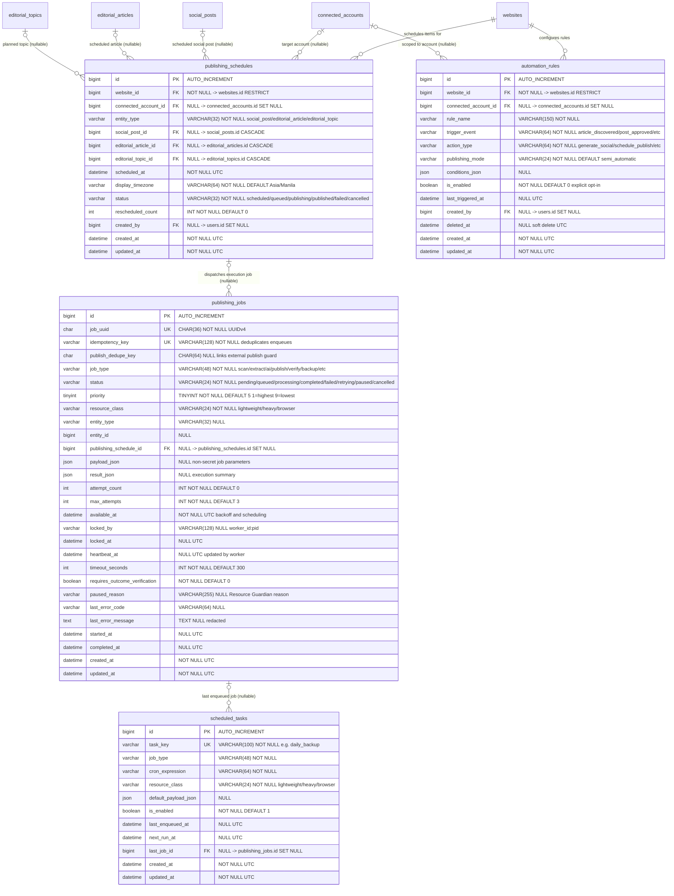

#### MySQL Persistent Job Queue Guarantees (Module 3.7 — Proposed Phase 6)

1. **Indexes on `publishing_jobs`:**
   - `uq_publishing_jobs_uuid (job_uuid)`
   - `uq_publishing_jobs_idempotency_key (idempotency_key)`
   - `ix_publishing_jobs_claim (status, priority, available_at, id)` — covers the transactional worker claim query.
   - `ix_publishing_jobs_stale (status, heartbeat_at, locked_at)` — covers stale worker crash recovery.
   - `ix_publishing_jobs_entity (entity_type, entity_id)` and `ix_publishing_jobs_dedupe (publish_dedupe_key)`.
2. **Transactional Claiming (Preventing Double Execution):**
   On MySQL 8.0+ (verified `8.0.45` locally), each worker claims work inside a single InnoDB transaction:
   ```sql
   START TRANSACTION;

   SELECT id
   FROM publishing_jobs
   WHERE status IN ('queued', 'retrying')
     AND available_at <= UTC_TIMESTAMP()
     AND resource_class IN (:allowed_resource_classes)
   ORDER BY priority ASC, available_at ASC, id ASC
   LIMIT 1
   FOR UPDATE SKIP LOCKED;

   UPDATE publishing_jobs
   SET status = 'processing',
       locked_by = :worker_id,
       locked_at = UTC_TIMESTAMP(),
       heartbeat_at = UTC_TIMESTAMP(),
       started_at = COALESCE(started_at, UTC_TIMESTAMP()),
       attempt_count = attempt_count + 1,
       updated_at = UTC_TIMESTAMP()
   WHERE id = :claimed_id;

   COMMIT;
   ```
   Two concurrent workers can never claim the same row.
3. **Idempotency Keys:** Every enqueue computes a deterministic `idempotency_key` (e.g., `scan:website:{id}:{window}` or `publish:social:{post_id}:v{schedule_rev}`) enforced by `uq_publishing_jobs_idempotency_key`. Re-running aaPanel Cron safely no-ops on duplicate key conflicts.
4. **Retries & Exponential Backoff:** Transient failures transition to `retrying` with `available_at = UTC_TIMESTAMP() + INTERVAL (base_delay * POW(2, attempt_count - 1)) SECOND` (capped, with jitter) while `attempt_count < max_attempts`, else terminal `failed`.
5. **Worker Heartbeat & Stale Job Recovery:** While running, the worker updates `heartbeat_at` every 30 seconds. A recovery sweep finds rows where `status = 'processing'` and `COALESCE(heartbeat_at, locked_at) < UTC_TIMESTAMP() - INTERVAL timeout_seconds SECOND`:
   - If the job is a non-publishing task (scan/extract/AI), it releases the lock and moves to `retrying` (or `failed` if attempts exhausted).
   - If the job is `scheduled_publish`, it **never blinds-retries**: it sets `requires_outcome_verification = 1` and enqueues/runs `publish_verify` first!
6. **Duplicate Publishing Prevention:** Before retrying any `scheduled_publish` job whose prior attempt had an ambiguous outcome (network timeout, worker crash, 5xx after send), the worker executes `publish_verify` against the official platform API (and checks `publishing_logs` / `social_posts.external_post_id` / `publish_dedupe_key`). If the post already exists externally, it records `verified_exists`, saves `external_post_id`/`published_url`, and marks the job `completed` without re-posting.

---

### 3.8 Analytics, Resource Monitoring and Backups *(Proposed — Phase 6)*

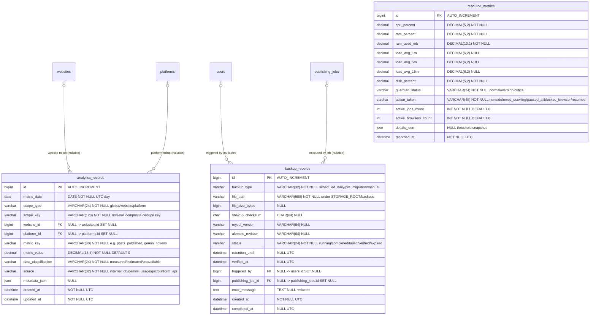

#### Table Constraints, Indexes & Policies (Module 3.8 — Proposed Phase 6)

- **`analytics_records`**:
  - **PK:** `id`
  - **Unique:** `uq_analytics_records_rollup (metric_date, scope_key, metric_key, source)` — uses non-null `scope_key` (e.g., `global`, `brand:4`, `website:12`, `platform:facebook`) because MySQL treats `NULL` values as distinct in `UNIQUE` indexes.
  - **Indexes:** `ix_analytics_records_brand_date (brand_id, metric_date)`, `ix_analytics_records_classification (data_classification)` — enforces transparent separation between `measured`, `estimated`, and `unavailable` data.
  - **Retention:** Retained 730 days (2 years).
- **`resource_metrics`**:
  - **PK:** `id`
  - **Indexes:** `ix_resource_metrics_recorded_at (recorded_at)`, `ix_resource_metrics_status_recorded (guardian_status, recorded_at)`
  - **Retention:** Raw `psutil` samples pruned after 30 days to keep table footprint minimal on shared hosting.
- **`backup_records`**:
  - **PK:** `id`
  - **Indexes:** `ix_backup_records_status_retention (status, retention_until)`, `ix_backup_records_created_at (created_at)`
  - **Retention:** Dump files stored outside the replaceable app directory (`STORAGE_ROOT/backups`) follow `backups.retention_days` (default 14 days); metadata rows are marked `expired` when the dump file is rotated and kept for 365 days.

---

## 4. State Lifecycles (Mermaid State Diagrams)

### 4.1 Publishing Approval Lifecycle

Applies to `social_posts.approval_status` and `editorial_articles.status`. **Semi-automatic** (human approval required) is the default mode.

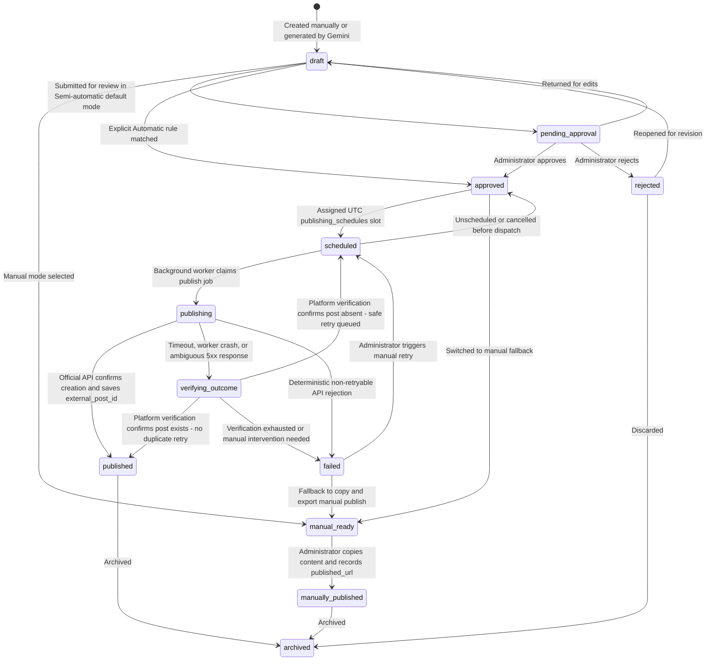

### 4.2 Background Job Lifecycle

Applies to `publishing_jobs.status` in the MySQL persistent job queue, incorporating Resource Guardian throttling, transactional claiming, heartbeats, stale job recovery, and duplicate-publish verification.

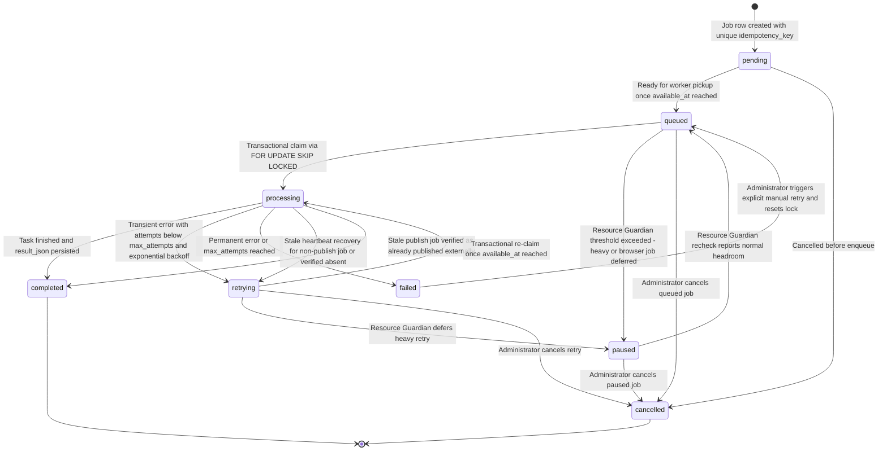

---

## 5. Incremental Migration Plan & Operational Commands

Migrations are authored strictly per roadmap phase to preserve stability and support safe rollback:

1. **Phase 1 (`20261126_0001` — Implemented & Live MySQL Verified):** `users`, `sessions`, `application_settings`, `activity_logs`
2. **Phase 2 (`20261126_0002` — Implemented & Live MySQL Verified):** `brands`, `media_assets`, `websites`, `source_articles`, `source_article_revisions`, `website_scan_logs`
3. **Phase 2.1 (`20261127_0003` — Implemented & Live MySQL Verified):** Website-centric merge (`website_categories`, `website_discovery_sources`, `website_url_rules`, `website_contents`, `content_revisions`, `website_scan_items`)
4. **Phase 3 (`20261127_0004` — Implemented & Live MySQL Verified):** `platforms`, `social_profiles`, `ai_providers`, `website_knowledge_profiles`, `website_knowledge_profile_revisions`, `prompt_templates`, `prompt_template_revisions`, `ai_response_cache`, `ai_generation_jobs`, `ai_generation_logs`, `social_posts`, `social_post_revisions`, plus `websites.auto_generate_require_published_at` and `websites.auto_generate_context_mode`
5. **Phase 3 Keyword Mapping & Content Approval (`20261127_0005` — Implemented & Live MySQL Verified):** `content_keywords` (one focus keyphrase, secondary keywords, anchor text variations, image-specific alt suggestions, version, `is_admin_locked`), `content_keyword_revisions`, `content_approvals` (`awaiting_extraction`, `pending_review`, `approved`, `rejected`, `needs_rereview`, plus `auto_generation_triggered_at`), and `content_approval_history`
6. **Phase 4:** Live publishing schedules & logs (`publishing_schedules`, `publishing_logs`, OAuth tokens)
7. **Phase 5:** `keyword_research`, `editorial_plans`, `editorial_topics`, `editorial_articles`, `editorial_article_revisions`
8. **Phase 6:** `publishing_jobs`, `automation_rules`, `scheduled_tasks`, `analytics_records`, `resource_metrics`, `backup_records`
9. **Phase 7 — QA, Security and Deployment:** Schema verification, rollback testing, and backup/restore drills (no additional core tables)

### 5.1 Phase 3 Implemented ERD (`20261127_0004` & `20261127_0005` — InnoDB, `utf8mb4`)

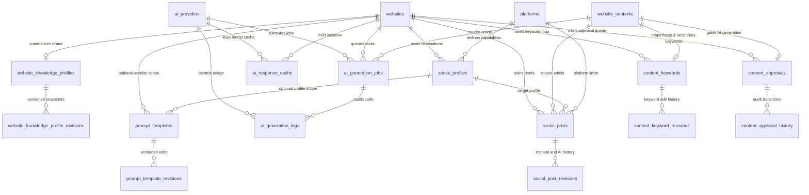

### Alembic & Diagnostic Commands

```bash
cd backend && source .venv/bin/activate

# Verify MySQL connectivity, version, InnoDB, and utf8mb4
python -m app.cli check-db

# Inspect generated MySQL DDL offline without connecting to MySQL
alembic upgrade head --sql

# Apply pending migrations to the configured development database
alembic upgrade head

# Check current applied revision
alembic current

# Roll back one revision (development only; always take a mysqldump backup first in production)
alembic downgrade -1
```

### Automated Testing Policy (Zero SQLite)

SQLite is strictly prohibited across the entire repository, including automated tests:
- **Fast unit/API tests (`pytest`):** Use explicit in-memory repository implementations conforming to the same repository protocols as SQLAlchemy repositories.
- **Live MySQL integration tests (`pytest -m mysql`):** Target an explicitly configured isolated test database via `CONTENTHUB_TEST_DATABASE_URL` (never production) to verify real MySQL connectivity, `InnoDB`, `utf8mb4`, and migrations.
